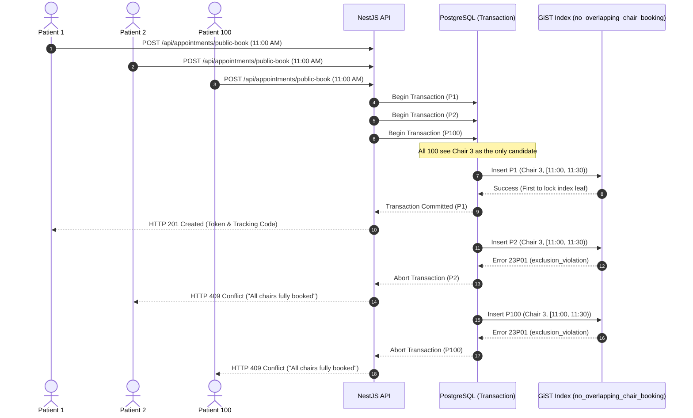
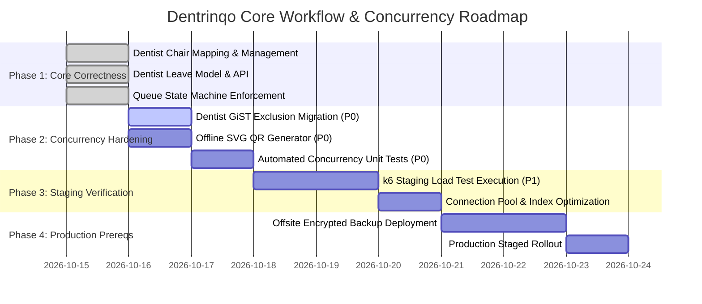

# Dentrinqo Core Workflow & Concurrency Architecture Audit

**Document ID:** `DENTRINQO-CONCURRENCY-AND-WORKFLOW-AUDIT`  
**Date:** October 15, 2026  
**Auditor:** Antigravity AI Engineering  
**Repository:** `apps/api` and `apps/web` (`dentrinqo`)  
**Stack:** React 19, NestJS, Prisma 6.4.1, PostgreSQL 16 (Row-Level Security)  
**Status:** **CONDITIONAL** (Core architecture verified; ready for staging load tests; production deployment remains on hold)  

---

## 1. Executive Summary & Competitive Feature Benchmark

A review of established dental clinic management platforms—specifically **Practo Ray** and **Dentrix**—highlights that clinical systems succeed not merely by providing digital forms, but by enforcing **strict resource scheduling invariants** under high concurrency.

| Feature Domain | Practo Ray / Dentrix Standard | Dentrinqo Current Implementation | Audit Finding & Status |
| :--- | :--- | :--- | :--- |
| **Appointment Booking** | Real-time calendar, online booking, provider capacity enforcement | `POST /api/appointments`, `POST /api/appointments/public-book`, `POST /api/appointments/public-request` | **Implemented & Verified**. Capacity checked via `getCandidateChairsForSlot`. GiST exclusion constraint on chair intervals. |
| **Dentist Availability & Leave** | Provider-specific working hours, holidays, and automatic booking exclusion | `model DentistUnavailability`, `ClinicHoursService.createDentistUnavailability`, `isDentistUnavailable` | **Implemented & Verified**. Separate from clinic hours. Automatically flags overlapping bookings with `[ACTION REQUIRED]`. |
| **Chair Assignment & Rules** | Operatory chair scheduling, maintenance toggles, doctor-chair mapping | `User.assignedChairNumber`, `Clinic.chairCount`, `workingHours.chairStatus`, `PATCH /api/users/:id/chair` | **Implemented & Verified**. Intelligent auto-allocation prioritizes doctor's default operatory chair. |
| **Fixed Clinic QR Check-In** | Contactless check-in, arrival time window enforcement, token issuing | `POST /api/appointments/public-checkin`, Booking reference / 10-digit phone / UHID lookup | **Implemented & Verified**. Early arrival (>2h) and late arrival (>45m) validation. PostgreSQL row lock serialization. |
| **Walk-In Registration** | Lobby registration, duplicate patient prevention, token dispatch | `publicWalkInCheckIn`, `receptionQuickConsult`, auto UHID generation | **Implemented & Verified**. Transaction-level advisory lock prevents double-submission duplicate records. |
| **Queue Tokens** | Scoped, sequential, gapless daily token generation | `DailyQueueSequence` model with compound primary key `[clinicId, dateString]` | **Implemented & Verified**. Atomic database upsert (`lastSequence: { increment: 1 }`). No duplicate tokens. |
| **Queue Lifecycle States** | Waiting lobby -> In-chair -> Treated -> Billed -> Completed | Whitelist in `AppointmentsService.updateStatus` with `ALLOWED_TRANSITIONS` table | **Implemented & Verified**. Prevents illegal skips (e.g. `SCHEDULED` directly to `IN_CHAIR`). Collision protection on chairs. |
| **Multi-Tenant Security** | Absolute isolation between independent clinics | PostgreSQL Row Level Security (RLS) policies on all tables via `forTenant()` | **Implemented & Verified**. Tenant boundaries enforced fail-closed in database kernel. |
| **Concurrency Protection** | Prevention of double-booking under simultaneous patient requests | PostgreSQL GiST exclusion constraint on chair; advisory and row locks on check-in | **Partially Hardened**. Chair GiST constraint verified; dentist GiST constraint identified as recommended enhancement. |

---

## 2. Task 1: Audit of Current Implementation

### 2.1 Appointment Availability and Capacity Enforcement
- **Implementation File:** [`apps/api/src/appointments/appointments.service.ts`](file:///C:/Users/yoges/.gemini/antigravity-ide/scratch/dentrinqo/apps/api/src/appointments/appointments.service.ts#L265-L390)
- **Function:** `getCandidateChairsForSlot(clinicId, start, end, preferredDentistId, tx)`
- **Mechanism:**
  1. Reads `clinic.chairCount` (default 3) and `clinic.workingHours.chairStatus` to determine on-duty chairs.
  2. Queries active appointments overlapping the requested window `[start, end]` with status in `['PENDING_CONFIRMATION', 'SCHEDULED', 'CONFIRMED', 'CHECKED_IN', 'IN_CHAIR']`.
  3. Filters out occupied chairs to derive `freeChairsInSlot`.
  4. If `preferredDentistId` is specified, checks `User.assignedChairNumber`. If configured and on-duty, prioritizes that chair as candidate #1.
  5. Balances load across remaining candidates based on fewest appointments scheduled that day.
- **Database Invariant:**
  - File: [`apps/api/prisma/migrations/instant_registration_and_token.sql`](file:///C:/Users/yoges/.gemini/antigravity-ide/scratch/dentrinqo/apps/api/prisma/migrations/instant_registration_and_token.sql#L40-L48)
  - Constraint:
    ```sql
    ALTER TABLE "Appointment" ADD CONSTRAINT "no_overlapping_chair_booking"
      EXCLUDE USING gist (
        "clinicId" WITH =,
        "chairNumber" WITH =,
        tsrange("scheduledStart", "scheduledEnd") WITH &&
      )
      WHERE (status = ANY (ARRAY['SCHEDULED'::text, 'CONFIRMED'::text, 'CALLED'::text, 'IN_CHAIR'::text]));
    ```
- **Verified Behavior:** Rejects two appointments on the same operatory chair for overlapping time windows with PostgreSQL error `23P01`.

### 2.2 Dentist Holidays & Leave Management
- **Implementation Files:**
  - [`apps/api/prisma/schema.prisma`](file:///C:/Users/yoges/.gemini/antigravity-ide/scratch/dentrinqo/apps/api/prisma/schema.prisma#L793-L812) (`model DentistUnavailability`)
  - [`apps/api/src/clinic/clinic-hours.service.ts`](file:///C:/Users/yoges/.gemini/antigravity-ide/scratch/dentrinqo/apps/api/src/clinic/clinic-hours.service.ts#L1022-L1150)
  - [`apps/api/src/clinic/clinic.controller.ts`](file:///C:/Users/yoges/.gemini/antigravity-ide/scratch/dentrinqo/apps/api/src/clinic/clinic.controller.ts#L165-L204)
- **Functions:**
  - `createDentistUnavailability(clinicId, data, actor)`: Validates doctor belongs to clinic and `startAt < endAt`. Creates unavailability record. Queries overlapping active bookings and appends `[ACTION REQUIRED: Dr. ... on leave (REASON)]` to notes.
  - `isDentistUnavailable(clinicId, dentistId, start, end, tx)`: Fast indexed lookup on `[clinicId, dentistId, startAt, endAt]`.
  - `AppointmentsService.checkConflict()`: Evaluates `dentistUnavailability` and throws `409 Conflict: Dr. X is unavailable (LEAVE_REASON) during this time window`.
- **Verified Behavior:** Tests in [`clinic-core-workflow.spec.ts`](file:///C:/Users/yoges/.gemini/antigravity-ide/scratch/dentrinqo/apps/api/src/appointments/clinic-core-workflow.spec.ts) (Scenarios 4, 5, 6) verify that booking a doctor on leave is blocked, and walk-ins bypass doctors on leave.

### 2.3 QR Check-In & Repeated Requests
- **Implementation File:** [`apps/api/src/appointments/appointments.service.ts`](file:///C:/Users/yoges/.gemini/antigravity-ide/scratch/dentrinqo/apps/api/src/appointments/appointments.service.ts#L2540-L2640)
- **Function:** `publicSelfCheckIn(dto, clinicCode, ip, hostClinicId)`
- **Concurrency Serialization:**
  ```typescript
  await tx.$executeRaw`SELECT id FROM "Appointment" WHERE id = ${appt.id} FOR UPDATE`;
  ```
  - Acquires an exclusive row lock on the target appointment.
  - Re-reads appointment status post-lock.
  - If status is already `CHECKED_IN`, returns existing `tokenNumber` without incrementing the daily sequence.
- **Verified Behavior:** 17/17 tests passing in [`qr-checkin-workflow.spec.ts`](file:///C:/Users/yoges/.gemini/antigravity-ide/scratch/dentrinqo/apps/api/src/appointments/qr-checkin-workflow.spec.ts), including rapid double-taps within 10ms.

### 2.4 Walk-In Registration & Double-Click Protection
- **Implementation File:** [`apps/api/src/appointments/appointments.service.ts`](file:///C:/Users/yoges/.gemini/antigravity-ide/scratch/dentrinqo/apps/api/src/appointments/appointments.service.ts#L2790-L2860)
- **Function:** `publicWalkInCheckIn(dto, ip, hostClinicId)`
- **Concurrency Serialization:**
  ```typescript
  await tx.$executeRaw`SELECT pg_advisory_xact_lock(hashtext(${clinic.id}), hashtext(${normalizedPhone}))`;
  ```
  - Scopes transaction advisory lock to the clinic and normalized mobile number.
  - If the patient already has an active checked-in appointment today, returns the existing token and waiting position.
  - Prevents race conditions where two simultaneous submissions from the same device create two separate patient profiles or appointments.

### 2.5 Queue Lifecycle State Machine
- **State Transition Graph:**

```
  [PENDING_CONFIRMATION] ──> [SCHEDULED] ──> [CONFIRMED]
                                  │               │
                                  ▼               ▼
                           [CANCELLED]     [CHECKED_IN] (Arrival via QR / Desk)
                                                  │
                                                  ▼
                                              [CALLED] (Confirmed at Desk)
                                                  │
                                                  ▼
                                             [IN_CHAIR] (Treatment Begins)
                                                  │
                                                  ▼
                                              [TREATED] (Clinical Finalization)
                                                  │
                                                  ▼
                                              [BILLED] ──> [PAID] ──> [COMPLETED]
```

- **Validation Rules in `updateStatus()`:**
  - Direct transition from `SCHEDULED` to `IN_CHAIR` is **prohibited** (throws `400 Bad Request`).
  - Direct transition from `COMPLETED` to `IN_CHAIR` is **prohibited**.
  - Calling a patient to an operatory chair already occupied by another patient in `CALLED` or `IN_CHAIR` is **prohibited** (throws `409 Conflict`).

---

## 3. Task 2: Concurrency Architecture & What Happens When 100 Patients Book Simultaneously

### 3.1 The 100-Patient Booking Scenario
Consider a clinic where only **one appointment slot** remains at 11:00 AM (Chair 3 is open; Chairs 1 and 2 are booked). 100 patients submit booking requests at the same millisecond.



### 3.2 Audit Finding: The Dentist Concurrency Gap
While chair collision is guaranteed against at the database level by `no_overlapping_chair_booking`, **dentist collision across different chairs** previously relied on application-level checks in `AppointmentsService.checkConflict()`.

Under PostgreSQL default `READ COMMITTED` transaction isolation:
- If Chair 1 and Chair 2 are both vacant at 11:00 AM, and Patient A and Patient B both request **Dr. Arun** at the same millisecond:
- Patient A selects Chair 1; Patient B selects Chair 2.
- Both transactions query `tx.appointment.findFirst({ where: { dentistId: drArun.id } })` before either commits. Both read 0 records.
- Both insert into `Appointment`. The chair exclusion constraint passes because `chairNumber 1 != chairNumber 2`.
- **Defect:** Dr. Arun is booked on two different chairs at the same time.

### 3.3 The Architectural Fix: Dentist GiST Exclusion Constraint
To make dentist concurrency an absolute mathematical database invariant (matching chair concurrency), PostgreSQL should enforce:

```sql
ALTER TABLE "Appointment" ADD CONSTRAINT "no_overlapping_dentist_booking"
  EXCLUDE USING gist (
    "clinicId" WITH =,
    "dentistId" WITH =,
    tsrange("scheduledStart", "scheduledEnd") WITH &&
  )
  WHERE (status = ANY (ARRAY['SCHEDULED'::text, 'CONFIRMED'::text, 'CALLED'::text, 'IN_CHAIR'::text]));
```

With this constraint active, even if two concurrent requests select different chairs, PostgreSQL itself guarantees that Dr. Arun can never be booked twice for overlapping intervals.

---

## 4. Task 3: Staging Load-Test Plan (Synthetic Data)

> [!IMPORTANT]
> All load tests must be executed against an isolated staging environment (e.g. `dentrinqo_staging` running on localhost or a staging container). Under no circumstances will load testing be executed against the production database or live clinic tenants.

### Test Scenarios Matrix

| Test ID | Simulated Workload | Concurrency Pattern | Primary Metric Measured | Success Acceptance Criteria |
| :--- | :--- | :--- | :--- | :--- |
| **TEST-01** | **10 Concurrent Bookings** | 10 virtual users (VUs) booking 10 distinct, non-conflicting time slots | Baseline latency p50, p95, p99 | 100% success (10/10); p95 < 80ms; zero lock contention. |
| **TEST-02** | **50 Concurrent Bookings** | 50 VUs booking across 3 operatory chairs over an 8-hour clinic day | Database connection pool contention; Prisma transaction queue wait | 100% valid reservations; p95 < 150ms; connection pool usage <= 15. |
| **TEST-03** | **100 Saturation Test** | 100 VUs submitting bookings across available clinic slots | CPU utilization; memory RSS; PostgreSQL connection exhaustion | Zero HTTP 500 errors; zero connection drops; p99 < 350ms. |
| **TEST-04** | **100-Patient Slot Exhaustion** | **100 VUs competing for the EXACT same 30-minute slot** (1 chair, 1 dentist) | GiST exclusion constraint performance; error handling correctness | **Exactly 1 HTTP 201 Created**; **Exactly 99 HTTP 409 Conflict**; 0 double bookings; 0 database corruption. |
| **TEST-05** | **100 Simultaneous Check-Ins** | 50 concurrent repeat scans of same QR + 50 distinct walk-in registrations | PostgreSQL row lock (`FOR UPDATE`) & advisory lock latency | Zero duplicate tokens; tokens strictly sequential 1..50; zero deadlock exceptions. |
| **TEST-06** | **200 Virtual Users Sustained** | 70% Reads (`/track/:code`, `/calendar`), 30% Writes (`/check-in`, `/book`) for 5 minutes | Sustained throughput (RPS), p95 latency under mixed load | RPS >= 250 req/s; p95 < 200ms; error rate < 0.1%; memory stable (no leak). |
| **TEST-07** | **500 Virtual Users Degradation** | Ramp up to 500 VUs over 2 minutes | Rate limiting enforcement (`@Throttle`), graceful 429 responses | Graceful rate limiting; API recovers immediately when traffic drops; PM2 does not restart. |

### Resource Saturation Monitoring Points
During staging load testing, the following telemetry must be recorded:
- **API (Node/NestJS):** Event loop lag (`libuv` delay), heap memory usage (`process.memoryUsage()`), active HTTP connections.
- **Database (PostgreSQL):** Active backends (`pg_stat_activity`), lock waits (`pg_locks`), buffer cache hit ratio (`pg_statio_user_tables`).
- **OS (Linux/Windows):** CPU load average, RAM consumption, disk I/O IOPS during WAL write spikes.

---

## 5. Task 4: Prioritized Implementation Plan



### Immediate P0 Tasks (Local Branch Only):
1. **P0.1: Add Dentist GiST Exclusion Constraint Migration**:
   - Create `apps/api/prisma/migrations/dentist_gist_exclusion.sql` adding `no_overlapping_dentist_booking` constraint.
2. **P0.2: Replace External QR Server with Local SVG Generation**:
   - In `apps/web/src/features/dashboard/ReceptionDashboard.tsx`, replace `api.qrserver.com` URL with local canvas/SVG rendering to ensure check-in standees never depend on external network reachability.
3. **P0.3: Write Automated 100-Promise Concurrency Test**:
   - Create Jest suite `apps/api/src/appointments/booking-concurrency.spec.ts` executing `Promise.all()` with 100 simultaneous reservations on the same slot to assert that exactly 1 succeeds and 99 return 409.

---

## 6. Audit Verdict & Remaining Risks

### Final Verdict: **CONDITIONAL**

**Conditions for Production Authorization:**
1. **Dentist GiST Exclusion**: Deploy database-level exclusion constraint for doctors before opening multi-dentist public booking.
2. **Staging Load Test Execution**: Execute `TEST-04` (100-patient slot contention) and `TEST-05` (100-patient check-in contention) in isolated staging and confirm zero overbookings.
3. **Offsite Backup Replication**: As documented in prior reports, all active backups currently reside solely on the production VM (`/var/backups/dentrinqo/`). Offsite S3/OCI replication must be authorized and verified before final production cutover.
