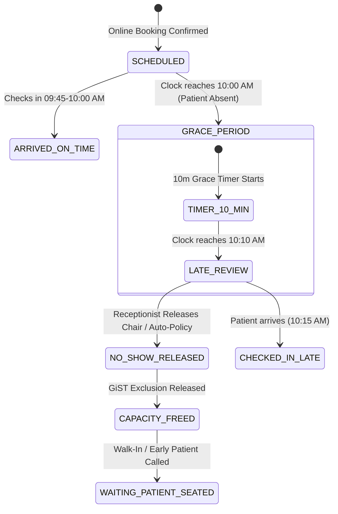

# Dentrinqo Dual-Track Scheduling & Intelligent Queue Architecture

**Document ID:** `DENTRINQO-SMART-SCHEDULING-ARCHITECTURE`  
**Date:** October 15, 2026  
**Architect:** Antigravity AI Engineering  
**System:** Dentrinqo Clinic Operating Platform  
**Target:** React 19, NestJS, Prisma 6.4.1, PostgreSQL 16 (PostGIS / btree_gist)  

---

## 1. The Core Dental Scheduling Dilemma

A dental clinic operates fundamentally differently from a generic hair salon or restaurant. A dental appointment requires:
1. An **Operatory Dental Chair** (Physical medical equipment).
2. A **Dentist / Surgeon** (Qualified human resource).
3. **Temporal Predictability** (Procedure duration: Scaling 30m, Root Canal 60m, Consultation 20m).

### The Scheduling Conflict:
- **Online Booked Patient:** Reserves a fixed future time window (e.g., 10:00–10:30 AM) with a specific doctor and chair.
- **Walk-In Patient:** Arrives unannounced at 9:40 AM seeking immediate care.

**The Catastrophic Failure Mode in Naive Systems:**  
If a walk-in at 9:40 AM is automatically allocated a 30-minute block (9:40–10:10 AM), the walk-in stomps directly into the confirmed 10:00 AM booking. When Patient C arrives on time at 9:55 AM for their 10:00 AM appointment, their chair is occupied, the doctor is busy, and reception descends into chaos.

---

## 2. The Solution: The Dual-Track Scheduling Architecture

Dentrinqo completely separates **Reserved Calendar Capacity** from the **Live Waiting Lobby Queue**, linking them through an intelligent **Dynamic Capacity Gap-Fitting Engine (DCGFE)**.

```
┌────────────────────────────────────────────────────────────────────────────────────────┐
│                               DENTRINQO SCHEDULING ENGINE                              │
├──────────────────────────────────────────┬─────────────────────────────────────────────┤
│ TRACK 1: RESERVED CALENDAR SLOTS         │ TRACK 2: LIVE WAITING LOBBY QUEUE           │
│ (Online Bookings & Pre-Scheduled Visits) │ (Walk-Ins & Arrived Booked Patients)       │
├──────────────────────────────────────────┼─────────────────────────────────────────────┤
│ • Strict start and end timestamps        │ • Scoped Daily Queue Tokens (#A001, #A002)  │
│ • Enforced by PostgreSQL GiST exclusion  │ • First-Come, First-Served priority         │
│ • Guaranteed doctor & chair availability │ • DOES NOT reserve fixed future time slots  │
│ • Blocks public booking engine           │ • Sits in lobby until a valid gap is found  │
└──────────────────────────────────────────┴─────────────────────────────────────────────┘
                                      │
                                      ▼
             ┌─────────────────────────────────────────────────┐
             │ DYNAMIC CAPACITY GAP-FITTING ENGINE (DCGFE)     │
             │ Calculates: Can this waiting patient be treated │
             │ now without colliding with the next booking?    │
             └─────────────────────────────────────────────────┘
```

---

## 3. The Dynamic Capacity Gap-Fitting Engine (DCGFE)

### 3.1 Mathematical Gap Formulation
Whenever a walk-in is waiting in the lobby or a doctor becomes free at time $T_{\text{now}}$, the engine calculates the **Available Treatment Gap** ($\Delta G$) for every operatory chair $c$ and doctor $d$:

$$\Delta G(c, d) = T_{\text{next\_scheduled}}(c, d) - \max(T_{\text{now}}, T_{\text{current\_actual\_end}}(c))$$

Where:
- $T_{\text{next\_scheduled}}(c, d)$ is the scheduled start time of the very next confirmed appointment on chair $c$ with doctor $d$.
- $T_{\text{now}}$ is the current wall-clock time.
- $T_{\text{current\_actual\_end}}(c)$ is when the patient currently in chair $c$ will finish.

### 3.2 Decision Rules Matrix

| Calculated Gap ($\Delta G$) | Required Procedure Time ($T_{\text{req}}$) | Engine Decision & System Action | Receptionist Display |
| :--- | :--- | :--- | :--- |
| $\Delta G \ge T_{\text{req}}$ (e.g. 40m gap $\ge$ 30m) | $30\text{ minutes}$ | **Eligible to Seat Immediately.** Seat walk-in into chair. | 🟢 **Open Gap (40m)** — [Seat Token #A004 Now] |
| $0 < \Delta G < T_{\text{req}}$ (e.g. 15m gap $<$ 30m) | $30\text{ minutes}$ | **Ineligible.** Stomps next booking. Patient remains waiting. | 🟡 **15m Gap Only** — Reserved for Patient C (10:00 AM). Next opening: 10:30 AM |
| $\Delta G \le 0$ (Chair in treatment) | Any | **Occupied.** Patient remains waiting. | 🔴 **Chair In Use** — Est. free at 10:00 AM |
| $\Delta G = \infty$ (No further bookings today) | Any | **Eligible to Seat Immediately.** Unlimited capacity. | 🟢 **Chair Fully Available** — [Seat Next Patient] |

---

## 4. Booked Patient Absence: The 10-Minute Grace Period Protocol

What happens when Patient A (booked for 10:00 AM) fails to arrive?

### 4.1 The Step-by-Step Lifecycle



### 4.2 Detailed Action Breakdown
1. **10:00 AM (Appointment Start):**
   - Patient A has not scanned the QR code or checked in at the desk.
   - System **does not** immediately cancel the appointment. Traffic, parking, or lobby delays are normal.
   - Chair 1 enters **Grace Period** (configurable, default: 10 minutes).
2. **10:00–10:10 AM (Protected Window):**
   - The slot remains reserved exclusively for Patient A.
   - Walk-in patients in the lobby wait. The receptionist dashboard shows:  
     *“Patient A (10:00 AM) — 6 minutes into arrival grace period.”*
3. **10:10 AM (Grace Period Expired):**
   - The status automatically updates to `LATE_REVIEW`.
   - The receptionist receives an actionable prompt:
     - `[ Call Patient A (Phone: 9876543210) ]`
     - `[ Release Chair & Call Next Waiting Patient (Token #A004) ]`
4. **10:10 AM (Slot Release Action):**
   - If receptionist clicks **Release Chair**:
     - Patient A’s status updates to `NO_SHOW` with timestamp and actor recorded.
     - The appointment record is **never deleted**; full medical and booking history is preserved.
     - The database GiST exclusion constraint on Chair 1 is **instantly freed** for the remainder of that window!
5. **10:12 AM (Walk-In Accommodated):**
   - Token #A004 (walk-in waiting in the lobby) is called to Chair 1!
   - Treatment proceeds smoothly from 10:12 to 10:42 AM.
6. **What if Patient A arrives late at 10:20 AM?**
   - Patient A scans QR code.
   - System recognizes their reference:  
     *“Your appointment was scheduled for 10:00 AM. Because arrival was past the 10-minute grace period, your chair was released. Please speak to the receptionist to be placed in the priority walk-in queue.”*
   - Zero double-booking; zero confrontation; clear clinic rules.

---

## 5. Multi-Dentist & Multi-Chair Dynamic Load Balancing

When a clinic has 3 dentists (Dr. Arun, Dr. Priya, Dr. Kumar) and 3 chairs:

```
TIME       CHAIR 1 (Dr. Arun)        CHAIR 2 (Dr. Priya)        CHAIR 3 (Dr. Kumar)
09:00 AM   [Patient A - Booked]      [AVAILABLE GAP - 30m]      [Patient D - Booked]
09:30 AM   [Patient B - Booked]      [Patient E - Booked]       [AVAILABLE GAP - 30m]
10:00 AM   [AVAILABLE GAP - 30m]     [Patient F - Booked]       [Patient G - Booked]
```

### 5.1 "First Available Dentist" Smart Router
If a walk-in patient arrives at 9:00 AM without specifying a doctor:
1. Engine inspects all chairs and active doctors.
2. Identifies that **Dr. Priya (Chair 2)** has an immediate 30-minute open gap from 9:00 to 9:30 AM!
3. Suggests immediately to the receptionist:  
   *“⚡ Dr. Priya (Chair 2) is free right now with a 30m open slot. Assign Walk-In?”*
4. Receptionist clicks `[Assign to Dr. Priya]`.
5. Atomic reservation commits. Chair 2 is occupied; Dr. Priya is booked; zero impact on Dr. Arun or Dr. Kumar!

---

## 6. Database Invariants & PostgreSQL Enforced Concurrency

Dentrinqo enforces these invariants at the database level using PostgreSQL GiST temporal exclusion constraints:

### 6.1 Operatory Chair Exclusion Constraint
```sql
ALTER TABLE "Appointment" ADD CONSTRAINT "no_overlapping_chair_booking"
  EXCLUDE USING gist (
    "clinicId" WITH =,
    "chairNumber" WITH =,
    tsrange("scheduledStart", "scheduledEnd") WITH &&
  )
  WHERE (status = ANY (ARRAY['SCHEDULED'::text, 'CONFIRMED'::text, 'CALLED'::text, 'IN_CHAIR'::text]));
```

### 6.2 Dentist Exclusion Constraint (The Double-Booking Guarantee)
```sql
ALTER TABLE "Appointment" ADD CONSTRAINT "no_overlapping_dentist_booking"
  EXCLUDE USING gist (
    "clinicId" WITH =,
    "dentistId" WITH =,
    tsrange("scheduledStart", "scheduledEnd") WITH &&
  )
  WHERE (status = ANY (ARRAY['SCHEDULED'::text, 'CONFIRMED'::text, 'CALLED'::text, 'IN_CHAIR'::text]));
```

### 6.3 Why This Guarantees Concurrency Safety:
- If 100 online requests and 5 walk-in check-ins hit the server simultaneously for overlapping times on the same doctor or chair:
- The first transaction commits.
- PostgreSQL throws `23P01` (`exclusion_violation`) for all others.
- The transactions abort cleanly with zero corrupted data, zero phantom slots, and zero double-bookings.
- When an appointment is released to `NO_SHOW` or `CANCELLED`, its status drops out of the `WHERE (status = ANY (...))` clause, making the slot instantly available for the next patient.

---

## 7. Actionable Implementation Deliverables

To bring this architecture to life in Dentrinqo:

1. **Database Migration (`dentist_gist_exclusion.sql`):** Apply `no_overlapping_dentist_booking` constraint.
2. **Gap Calculation Engine (`AppointmentsService.calculateAvailableGaps`):** Returns live available minutes before next booking for each doctor and chair.
3. **Grace Period & Release Endpoint (`releaseLateSlot`):** Allows 1-click chair release for patients past grace period.
4. **Reception UI Telemetry:** Live gap badges and Grace Period alert cards on `ReceptionDashboard.tsx`.
