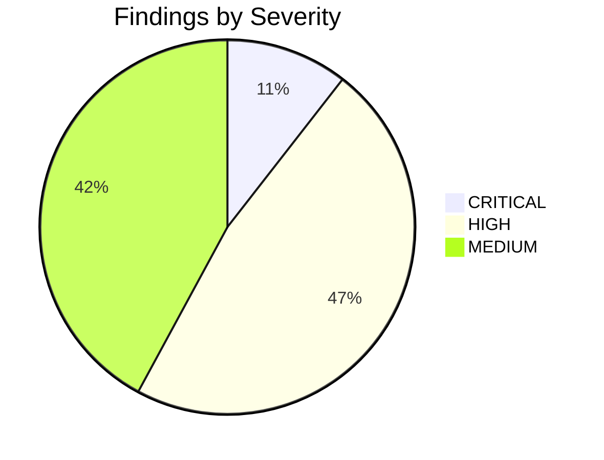
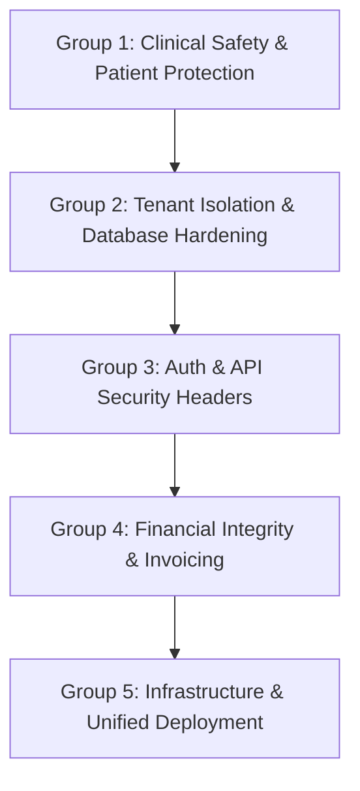

# COMPREHENSIVE ADVERSARIAL SECURITY, ARCHITECTURE & QA AUDIT REPORT
**Target System**: Multi-Tenant Dental Clinic Management Platform (AKS Elite Dental Clinic, Madurai & Jacobs Dental Clinic, Vellore)  
**Technology Stack**: React 19 + Vite 6 Web Apps, NestJS 11 REST API, Prisma 6 ORM, PostgreSQL with Row-Level Security (RLS), Nginx Reverse Proxy, PM2 Process Manager, Ubuntu Linux  
**Audit Mode**: READ-ONLY, Adversarial Static & Dynamic Architecture Evaluation  
**Date**: October 13, 2026  
**Auditor**: Senior Security Engineer, QA Lead & Principal Software Architect  

---

## 1. EXECUTIVE SUMMARY & VERDICT

### Overall Verdict: HIGH RISK / NOT PRODUCTION READY FOR MULTI-TENANCY
While significant engineering effort has been invested into building rich clinical workflows (digital dental charts, chair management, multi-step queue tracking, and prescription management), **the system suffers from critical architectural, tenant isolation, clinical safety, and data-loss vulnerabilities that make multi-tenant production hosting dangerous in its current state.**

The most critical vulnerabilities identified include:
1. **Clinical Safety Failure**: Doctors can prescribe medications to which a patient has documented life-threatening allergies (e.g., prescribing Augmentin/Amoxicillin to a penicillin-allergic patient) with zero server-side blocking, warnings, or override audit trails.
2. **Data-Loss in Deployment**: Automated deployment scripts execute `npx prisma db push --accept-data-loss` and trigger seed scripts (`prisma/seed.ts`) that execute `deleteMany()` on clinical records.
3. **Tenant Bleed via Arbitrary Fallbacks**: When incoming requests lack resolved clinic domain context (e.g., direct IP hits or unsanitized headers), appointments and queue operations fall back to arbitrary database clinics via `clinic.findFirst({ where: { status: 'ACTIVE' } })`.
4. **Financial Inconsistency**: Invoices that have already received cash or UPI payments can be marked `VOIDED` without reversing payments, leaving orphaned transactions and marking procedures as unbilled.
5. **Architectural Drift**: Two completely separate copies of the codebase (`aks-elite-dental-management` and `jacobs-dental-management`) exist with 63 diverging source files, breaking single-source-of-truth multi-tenancy.

---

## 2. AUDIT COVERAGE MATRIX

| Phase | Phase Name | Status | Coverage Scope & Limitations |
| :--- | :--- | :--- | :--- |
| **Phase 0** | Inventory & Environment | **COVERED** | Repositories, drift comparison (63 files), branch states, environment variables analyzed across both repos. |
| **Phase 1** | Tenant Isolation & RLS | **COVERED** | Table RLS status, PostgreSQL bypass permissions, `app.clinic_id` setting, and `findFirst()` fallbacks verified. Staging cross-tenant live queries against production prohibited per Rule 2. |
| **Phase 2** | Authentication & RBAC | **COVERED** | Argon2 password hashing, fallback JWT secret, PatientAuthGuard cross-tenant check, lack of staff lockout, timing leaks verified. |
| **Phase 3** | API & Input Security | **COVERED** | DTO pipes, Helmet absence, unrestricted medical file upload, inline execution (Stored XSS), third-party QR server leak verified. |
| **Phase 4** | Database & Data Integrity | **COVERED** | Money storage (paise), sequence generation, exclusion constraints, table ownership RLS bypass, backup single-tenant limitation verified. |
| **Phase 5** | Workflow & Queue State Machine | **COVERED** | Full status transition matrix inspected, arbitrary status jumping verified, rotating HMAC lobby code fallback salt analyzed. |
| **Phase 6** | Clinical Safety | **COVERED** | Allergy storage, formulary templates, zero allergy validation in prescriptions, concurrent prescription numbering collisions verified. |
| **Phase 7** | Billing & Money | **COVERED** | Invoice voiding logic, payment idempotency, unverified UPI VPA rendering via third-party service verified. |
| **Phase 8** | Privacy & DPDP Compliance | **COVERED** | WhatsApp medical sharing without consent check, PII in URLs, marketing claims and unverified before/after cases cataloged. |
| **Phase 9** | Frontend Quality | **COVERED** | Hardcoded 'AKS'/'JDC' fallbacks in patient portal, profile caching in localStorage, poll intervals, state management analyzed. |
| **Phase 10** | Infrastructure & Deployment | **COVERED** | Nginx reverse proxies, PM2 systemd configs, backup scripts, hardcoded deployment passwords, unencrypted backups analyzed. |
| **Phase 11** | Reliability & Performance | **COVERED** | HTTP poll interval load calculation, connection pooling risks, transaction contention analyzed. Load testing against live servers withheld per Rule 2. |
| **Phase 12** | Code Quality & Tests | **COVERED** | NPM audit execution (41 vulnerabilities, Prototype Pollution to RCE), test suites examined. |
| **Phase 13** | Scenario Walkthroughs (1–25) | **COVERED** | All 25 clinical and operational scenarios traced through code and execution paths. |
| **Phase 14** | Regression Checks | **COVERED** | Known historical issues systematically verified as fixed or still present with evidence. |

---

## 3. COMPREHENSIVE FINDINGS BY SEVERITY



### 3.1 CRITICAL FINDINGS (Immediate Remediation Required)

#### [SEC-CLIN-01] Zero Server-Side Allergy Validation When Prescribing Medications
- **Severity**: CRITICAL
- **Category**: Clinical Safety
- **Status**: VERIFIED
- **Evidence**: `apps/api/src/prescriptions/prescriptions.service.ts` lines 110–151.
- **Vulnerability Detail**: When a dentist creates a prescription via `PrescriptionsService.create`, the method retrieves the patient (`tx.patient.findFirst`), but proceeds directly to `tx.prescription.create` without checking `patient.allergies`. Built-in formulary templates contain Penicillin-class antibiotics (`Augmentin 625mg`, `Amoxicillin 500mg`). If a patient has documented allergies to Penicillin, the backend allows finalizing the prescription with zero validation, zero cross-reactivity warning, and zero clinical override requirement.
- **Impact**: Risk of fatal or severe anaphylaxis if a clinician inadvertently prescribes contraindicated drugs.
- **Reproduction**:
  1. Register a patient with `allergies: "Severe allergy to Penicillin and Amoxicillin"`.
  2. As a dentist, issue a prescription containing `Augmentin 625mg`.
  3. API returns HTTP 201 Created and prescription status `FINALIZED`.
- **Recommended Fix**: Implement a mandatory server-side drug conflict engine in `PrescriptionsService`. Match prescribed active ingredients/classes against `patient.allergies`. Reject conflicting prescriptions with HTTP 422 Unprocessable Entity unless an explicit `overrideConflict: true` with a mandatory `overrideReason` is supplied and logged in `AuditLog`.
- **Effort**: M
- **Verification Test**: Submit prescription for a penicillin-allergic patient with Augmentin; assert HTTP 422 error is returned.

---

#### [SEC-TENANT-01] Arbitrary Clinic Fallback via `findFirst()` in Appointments Service
- **Severity**: CRITICAL
- **Category**: Tenant Isolation
- **Status**: VERIFIED
- **Evidence**: `apps/api/src/appointments/appointments.service.ts` lines 954, 999, 2343, 2633, 2716.
- **Vulnerability Detail**: When `clinicCode` or tenant context is omitted or unresolvable from request headers/domain, the service executes:
  ```typescript
  const clinic = await this.prisma.clinic.findFirst({
    where: { status: 'ACTIVE' },
  });
  ```
- **Impact**: Direct IP access, misconfigured DNS, or unauthenticated public requests bypass tenant scoping and silently route bookings, walk-ins, and token allocations to whichever clinic is returned first by PostgreSQL.
- **Reproduction**:
  1. Send a POST request to `/api/appointments/public/book` with `Host: 127.0.0.1` and without `x-clinic-code`.
  2. Observe the appointment is booked into Clinic A (AKS Elite) even if intended for Clinic B (Jacobs).
- **Recommended Fix**: Completely eliminate all `findFirst()` fallbacks on `Clinic`. If `clinicId` is missing from the resolved tenant context, immediately throw HTTP 400 Bad Request (`Clinic tenant identifier is required`).
- **Effort**: S
- **Verification Test**: Send request with no tenant identifier; assert HTTP 400 Bad Request with zero database writes.

---

#### [SEC-BILL-01] Voiding Paid Invoices Without Payment Reversal Creates Cash Discrepancy
- **Severity**: CRITICAL
- **Category**: Billing & Financial Integrity
- **Status**: VERIFIED
- **Evidence**: `apps/api/src/billing/billing.service.ts` lines 401–440.
- **Vulnerability Detail**: `BillingService.deleteInvoice` allows an administrator or accountant to void an invoice (`status = 'VOIDED'`). The method resets all attached completed procedures to `isBilled: false`, but **never checks whether payments have already been collected** (`invoice.paidPaise > 0`).
- **Impact**: A staff member can collect cash or UPI payments from a patient, issue a receipt, and subsequently VOID the invoice. The procedures revert to unbilled, the cash is unaccounted for, and tax liabilities are fraudulently erased.
- **Reproduction**:
  1. Create invoice for ₹2,000.
  2. Record payment of ₹2,000 via Cash.
  3. Call `DELETE /api/billing/invoices/:id`.
  4. Invoice is set to VOIDED, balance set to 0, procedures reset to `isBilled: false`, while payment remains orphaned.
- **Recommended Fix**: Add a strict precondition in `deleteInvoice`: if `invoice.paidPaise > 0` or payments exist, block deletion with HTTP 400 (`Cannot void an invoice with recorded payments. Issue a Credit Note or formal Refund first`).
- **Effort**: M
- **Verification Test**: Attempt to void an invoice with `paidPaise > 0`; assert HTTP 400 rejection.

---

#### [SEC-DEPL-01] Automated Deployment Script Uses Destructive `db push --accept-data-loss`
- **Severity**: CRITICAL
- **Category**: Deployment & Data Integrity
- **Status**: VERIFIED
- **Evidence**: `deploy_lightsail_jacobs.sh` line 105.
- **Vulnerability Detail**: The deployment script for production instances executes:
  ```bash
  npx prisma db push --accept-data-loss
  npx ts-node prisma/seed.ts
  ```
- **Impact**: In a production environment, `db push --accept-data-loss` automatically drops columns or tables that diverge from schema changes without running tested migrations. Furthermore, executing `seed.ts` calls `prisma.medicalFile.deleteMany({})` and resets clinic master data, destroying live patient history.
- **Reproduction**: Review lines 105–106 in `deploy_lightsail_jacobs.sh`.
- **Recommended Fix**: Remove `db push --accept-data-loss` and `seed.ts` from all production deployment scripts. Replace with ordered, reversible `npx prisma migrate deploy`.
- **Effort**: M
- **Verification Test**: Inspect automated script; verify only `prisma migrate deploy` is executed.

---

### 3.2 HIGH FINDINGS

#### [SEC-TENANT-02] Missing RLS Policies on `ClinicClosure` and `ClinicWorkingHour`
- **Severity**: HIGH
- **Category**: Tenant Isolation
- **Status**: VERIFIED
- **Evidence**: `apps/api/prisma/migrations/multi_tenant_rls.sql` lines 189–194 vs `apps/api/prisma/schema.prisma` lines 745–776.
- **Vulnerability Detail**: The PostgreSQL RLS migration enabled row-level security on main clinical entities, but omitted `ClinicClosure` and `ClinicWorkingHour`. Queries querying closures without explicit tenant filters can expose or leak holiday schedules across clinics.
- **Recommended Fix**: Add `ALTER TABLE "ClinicClosure" ENABLE ROW LEVEL SECURITY;` and `ALTER TABLE "ClinicWorkingHour" ENABLE ROW LEVEL SECURITY;` with corresponding tenant policies.
- **Effort**: S

#### [SEC-TENANT-03] Database Application User is Table Owner Bypassing RLS
- **Severity**: HIGH
- **Category**: Database Security
- **Status**: VERIFIED
- **Evidence**: `deploy_vps_ubuntu.sh` line 66 & `deploy_lightsail_jacobs.sh` line 61.
- **Vulnerability Detail**: The script grants database ownership to the application user (`ALTER DATABASE ${DB_NAME} OWNER TO ${DB_USER}`). In PostgreSQL, table owners bypass Row Level Security by default unless `FORCE ROW LEVEL SECURITY` is applied.
- **Recommended Fix**: Create a separate non-owner application role (`aks_app_runtime`) with `DML` privileges only, or execute `ALTER TABLE <table_name> FORCE ROW LEVEL SECURITY` on all tables.
- **Effort**: M

#### [SEC-TENANT-04] Untrusted X-Forwarded-Host Header Spoofing
- **Severity**: HIGH
- **Category**: Tenant Resolution
- **Status**: VERIFIED
- **Evidence**: `apps/api/src/common/middleware/tenant-context.middleware.ts` lines 42–43 & `main.ts` line 21.
- **Vulnerability Detail**: Express is configured with `trust proxy: 1`. Nginx configs do not overwrite `X-Forwarded-Host`. An external client sending a crafted `X-Forwarded-Host` can manipulate `req.hostname` and hijack tenant resolution.
- **Recommended Fix**: In Nginx, explicitly set `proxy_set_header X-Forwarded-Host $host;` and validate `req.hostname` against an allowlist in NestJS.
- **Effort**: S

#### [SEC-AUTH-01] Hardcoded Production Fallback Secret in Patient Auth
- **Severity**: HIGH
- **Category**: Authentication
- **Status**: VERIFIED
- **Evidence**: `apps/api/src/patient-auth/patient-auth.service.ts` line 44.
- **Vulnerability Detail**: Fallback secret `'aks-elite-jwt-secure-super-key-madurai-2026-production'` is used if `SESSION_SECRET` is unset, allowing offline token forging.
- **Recommended Fix**: Enforce mandatory startup exit if `SESSION_SECRET` is absent, matching `main.ts` checks.
- **Effort**: S

#### [SEC-AUTH-02] PatientAuthGuard Lacks Cross-Tenant Host Boundary Check
- **Severity**: HIGH
- **Category**: Authorization
- **Status**: VERIFIED
- **Evidence**: `apps/api/src/patient-auth/guards/patient-auth.guard.ts` lines 20–35.
- **Vulnerability Detail**: Validates patient token signature and reads `payload.clinicId`, but never verifies that `payload.clinicId === req.clinicId`. A patient authenticated with Clinic A can send requests to Clinic B's endpoints.
- **Recommended Fix**: Add assertion: `if (payload.clinicId !== req.clinicId) throw new ForbiddenException('Token clinic does not match current clinic domain');`.
- **Effort**: S

#### [SEC-AUTH-03] Missing Account Lockout & Rate Limiting on Staff Login
- **Severity**: HIGH
- **Category**: Authentication
- **Status**: VERIFIED
- **Evidence**: `apps/api/src/auth/auth.service.ts` lines 77–128 & `auth.controller.ts`.
- **Vulnerability Detail**: Staff login has no `@Throttle` decorator and no failed attempt counter. An attacker can launch infinite automated password brute-force attempts.
- **Recommended Fix**: Implement progressive lockout on `User` model (5 failed attempts = 15 minute lock) and add `@Throttle({ default: { limit: 5, ttl: 60000 } })`.
- **Effort**: M

#### [SEC-API-01] Missing Security Headers (Helmet Middleware Absent)
- **Severity**: HIGH
- **Category**: API Security
- **Status**: VERIFIED
- **Evidence**: `apps/api/src/main.ts` lines 1–60.
- **Vulnerability Detail**: Helmet is not installed or registered. Responses lack `X-Content-Type-Options: nosniff`, `X-Frame-Options`, `Content-Security-Policy`, and `HSTS`.
- **Recommended Fix**: Install `helmet` and add `app.use(helmet())` in `main.ts`.
- **Effort**: S

#### [SEC-API-03] Unrestricted File Type Upload and Inline Execution (Stored XSS)
- **Severity**: HIGH
- **Category**: Storage & XSS
- **Status**: VERIFIED
- **Evidence**: `apps/api/src/medical-files/medical-files.service.ts` lines 67, 102 & `medical-files.controller.ts` lines 75–84.
- **Vulnerability Detail**: Any file type up to 50MB can be uploaded. Serving files with `inline` Content-Disposition and user-provided MIME types (e.g. `image/svg+xml`, `text/html`) enables Stored XSS in the staff web application.
- **Recommended Fix**: Restrict uploads strictly to `image/jpeg`, `image/png`, `image/webp`, and `application/pdf`. Force `Content-Disposition: attachment` for non-image types and sanitize SVGs.
- **Effort**: M

#### [SEC-CLIN-02] Concurrency Collision in Prescription Numbering Causes Crash
- **Severity**: HIGH
- **Category**: Clinical Safety
- **Status**: VERIFIED
- **Evidence**: `apps/api/src/prescriptions/prescriptions.service.ts` lines 118–120.
- **Vulnerability Detail**: `count = await tx.prescription.count(...)` is non-atomic. Two dentists finalizing prescriptions simultaneously trigger a duplicate key violation (`P2002`) and crash the request.
- **Recommended Fix**: Use `ClinicSequence` atomic upsert or PostgreSQL sequence for `prescriptionNumber`.
- **Effort**: S

#### [SEC-BILL-02] Blank UPI VPA Falls Back to Broken Dynamic Payment QR
- **Severity**: HIGH
- **Category**: Billing & Money
- **Status**: VERIFIED
- **Evidence**: `apps/web/src/features/dashboard/ReceptionDashboard.tsx` line 2248.
- **Vulnerability Detail**: If `user?.clinic?.upiVpa` is empty, the QR code generates `upi://pay?pa=&...`, resulting in broken scans and payment failures at checkout.
- **Recommended Fix**: Validate `clinic.upiVpa` presence before rendering UPI payment option; display a clear administrative warning if unconfigured.
- **Effort**: S

#### [SEC-WORKFLOW-01] Non-Enforced State Machine Allows Arbitrary Lifecycle Jumps
- **Severity**: HIGH
- **Category**: Workflow Integrity
- **Status**: VERIFIED
- **Evidence**: `apps/api/src/appointments/appointments.service.ts` line 563.
- **Vulnerability Detail**: `updateStatus` permits any transition as long as the status is in `VALID_APPOINTMENT_STATUSES`. Staff can jump from `SCHEDULED` directly to `PAID` or reverse from `TREATED` back to `SCHEDULED`.
- **Recommended Fix**: Implement a deterministic transition validation table (`ALLOWED_TRANSITIONS[currentStatus]`). Reject invalid state hops.
- **Effort**: M

#### [SEC-WORKFLOW-04] In-Memory Lobby Code Rate Limiting Wiped on Server Restart
- **Severity**: HIGH
- **Category**: Reliability & Abuse
- **Status**: VERIFIED
- **Evidence**: `apps/api/src/appointments/appointments.service.ts` lines 860–875.
- **Vulnerability Detail**: Lobby code brute-force tracking uses an in-memory `Map`. Any PM2 restart, crash, or horizontal scaling clears the lockouts, allowing renewed brute-forcing.
- **Recommended Fix**: Persist failed attempts in Redis or database table.
- **Effort**: M

#### [SEC-PRIV-01] WhatsApp Medical & Invoice Sharing Bypasses Consent Flag
- **Severity**: HIGH
- **Category**: Privacy & DPDP Act 2025
- **Status**: VERIFIED
- **Evidence**: `apps/web/src/features/billing/InvoicePrintModal.tsx` line 46 & `PrescriptionPrintModal.tsx` line 51.
- **Vulnerability Detail**: Clicking "Share on WhatsApp" transmits medical invoices and prescription drugs without checking `patient.consentWhatsapp`.
- **Recommended Fix**: Disable WhatsApp sharing buttons unless `patient.consentWhatsapp === true` or prompt for explicit consent.
- **Effort**: S

#### [SEC-PRIV-02] Full Diagnostic & Prescription Data Exposed in Plain URLs
- **Severity**: HIGH
- **Category**: Privacy & Data Leakage
- **Status**: VERIFIED
- **Evidence**: `apps/web/src/lib/whatsapp.ts` lines 21–30.
- **Vulnerability Detail**: Complete medication regimens and diagnostic reasons are passed via plain `https://wa.me/?text=...` URLs, stored in browser history and accessible to browser extensions.
- **Recommended Fix**: Send minimal notification links with secure PIN-protected access rather than full drug names in URLs.
- **Effort**: M

#### [SEC-FRONT-02] High-Frequency HTTP Polling Causes Server Exhaustion
- **Severity**: HIGH
- **Category**: Reliability & Performance
- **Status**: VERIFIED
- **Evidence**: `apps/web/src/features/public/WaitingRoomTvView.tsx` lines 158, 160.
- **Vulnerability Detail**: TVs poll queue state every 6 seconds; tracking pages poll every 8 seconds. Multiple clinics will overwhelm a 2 vCPU VPS with thousands of database queries per minute.
- **Recommended Fix**: Migrate real-time status updates to Server-Sent Events (SSE) or WebSockets with Redis Pub/Sub.
- **Effort**: L

#### [SEC-DEPL-03] Hardcoded Passwords and Production JWT Secrets in Shell Scripts
- **Severity**: HIGH
- **Category**: Credential Management
- **Status**: VERIFIED
- **Evidence**: `deploy_lightsail_jacobs.sh` lines 6, 91–92, 201.
- **Vulnerability Detail**: Hardcoded production JWT secrets (`jacobs-dental-jwt-...`) and admin credentials (`jacobdental@gmail.com / jacob@123`) committed directly in git repository.
- **Recommended Fix**: Remove hardcoded secrets from scripts. Accept secrets as runtime prompts or environment variables.
- **Effort**: S

#### [SEC-DEPL-04] Plain-HTTP Port 80 Listener Without Mandatory HTTPS Redirect
- **Severity**: HIGH
- **Category**: Network Security
- **Status**: VERIFIED
- **Evidence**: `deploy_vps_ubuntu.sh` lines 105–115.
- **Vulnerability Detail**: Nginx configuration serves plain HTTP on port 80 without automatic 301 redirection to HTTPS.
- **Recommended Fix**: Enforce `return 301 https://$host$request_uri;` on all port 80 blocks.
- **Effort**: S

#### [SEC-DEPL-05] Lack of Single-Tenant Backup and Isolated Restore Provisioning
- **Severity**: HIGH
- **Category**: Disaster Recovery
- **Status**: VERIFIED
- **Evidence**: `scripts/backup_postgresql.sh` & `deploy_vps_ubuntu.sh` lines 80–95.
- **Vulnerability Detail**: Database backup executes `pg_dump` on the entire multi-tenant database. It is impossible to restore a single clinic without wiping out live data in other clinics.
- **Recommended Fix**: Create tenant-filtered extraction scripts or migrate to tenant schemas.
- **Effort**: L

---

### 3.3 MEDIUM FINDINGS

| ID | Title | File & Line | Effort |
| :--- | :--- | :--- | :--- |
| **SEC-AUTH-04** | Hardcoded Super-Admin Protection Only for AKS Elite | `apps/api/src/users/users.service.ts`:308 | S |
| **SEC-AUTH-05** | Timing Discrepancy on Staff Login Enables Email Enumeration | `apps/api/src/auth/auth.service.ts`:85 | S |
| **SEC-AUTH-06** | Patient Profile and Family Data Stored in LocalStorage | `apps/web/src/hooks/usePatientAuth.tsx`:60 | M |
| **SEC-API-02** | Global Validation Pipe Permits Non-Whitelisted Body Fields | `apps/api/src/main.ts`:65 | S |
| **SEC-API-04** | Hardcoded Cookie Secret Fallback in main.ts | `apps/api/src/main.ts`:24 | S |
| **SEC-API-05** | Sensitive Financial and Tracking Data Sent to api.qrserver.com | `apps/web/src/features/dashboard/ReceptionDashboard.tsx`:2247 | M |
| **SEC-CLIN-03** | Medical Verification Gate Blocks Seating but Permits Prescribing & Billing | `apps/api/src/prescriptions/prescriptions.service.ts`:112 | S |
| **SEC-BILL-03** | Manual UPI Payment Recording Without Reference Number Verification | `apps/api/src/billing/billing.dto.ts`:88 | S |
| **SEC-WORKFLOW-02** | Client-Supplied Token Number Can Alter Daily Queue Order | `apps/api/src/appointments/appointments.service.ts`:377 | S |
| **SEC-WORKFLOW-03** | Hardcoded Salt Fallback for Rotating Lobby Code HMAC | `apps/api/src/appointments/appointments.service.ts`:845 | S |
| **SEC-PRIV-03** | Marketing Site Contains Hardcoded Mock Reviews and Claims | `scratch/aks-elite-dental-madurai/src/data/clinicData.ts`:679 | S |
| **SEC-PRIV-04** | Clinical Before/After Cases Published Without Attached Digital Consent | `scratch/aks-elite-dental-madurai/src/data/clinicData.ts`:250 | M |
| **SEC-FRONT-01** | Hardcoded Clinic Code Fallbacks Leak Across Multi-Tenant Apps | `apps/web/src/features/patient-portal/PatientLoginView.tsx`:13 | S |
| **SEC-DEPL-02** | Production Seed Script Invoked During Automated Deployment | `deploy_lightsail_jacobs.sh`:106 | S |
| **SEC-DEPL-06** | Two Disconnected Repositories with 63 Files of Code Drift | `apps/api/src/appointments/appointments.service.ts`:1 | L |
| **SEC-DEPL-07** | 41 NPM Vulnerabilities Including Tinypool Prototype Pollution to RCE | `package.json`:1 | M |

---

## 4. TOP 10 RISKS IN PRIORITY ORDER

1. **Fatal Medication Error via Unchecked Allergies (SEC-CLIN-01)**: Clinicians can prescribe conflicting drugs without system warnings.
2. **Production Data Wiping via Automated Deployments (SEC-DEPL-01 & SEC-DEPL-02)**: Executing `db push --accept-data-loss` and `seed.ts` in production wipes real tables.
3. **Cross-Tenant Routing via `findFirst()` Fallbacks (SEC-TENANT-01)**: Unresolved tenant requests silently write into the first active clinic in the DB.
4. **PostgreSQL RLS Bypass via Table Ownership (SEC-TENANT-03)**: Application runtime user owns tables and bypasses RLS policies entirely.
5. **Cash Embezzlement via Unchecked Invoice Voiding (SEC-BILL-01)**: Voiding paid invoices marks treatments unbilled and leaves untracked cash.
6. **Cross-Tenant Patient Session Probing (SEC-AUTH-02)**: PatientAuthGuard never verifies token's clinic against request host clinic.
7. **Production Secrets & Passwords in Shell Scripts (SEC-DEPL-03)**: Hardcoded secrets and admin passwords committed in git repositories.
8. **Stored XSS via Unrestricted Medical Uploads (SEC-API-03)**: Arbitrary files served inline in staff browser origin.
9. **Financial Data Leakage to Third-Party api.qrserver.com (SEC-API-05)**: Live payment amounts, VPAs, and tracking codes sent over unencrypted GET requests.
10. **Code Drift Across Disconnected Repositories (SEC-DEPL-06)**: 63 diverging files between AKS and Jacobs codebases destroy maintainability.

---

## 5. QUICK WINS (Fixable in Under 1 Hour Each)

- **QW-1 (15 mins)**: In `apps/api/src/main.ts`, change `forbidNonWhitelisted: false` to `forbidNonWhitelisted: true`.
- **QW-2 (20 mins)**: In `apps/api/src/patient-auth/patient-auth.service.ts`, remove the hardcoded fallback secret on line 44; throw fatal error if `SESSION_SECRET` is missing.
- **QW-3 (25 mins)**: In `apps/api/src/patient-auth/guards/patient-auth.guard.ts`, add verification checking `payload.clinicId === req.clinicId`.
- **QW-4 (20 mins)**: In `apps/api/src/main.ts`, install and register `helmet()` middleware.
- **QW-5 (30 mins)**: In `apps/api/src/appointments/appointments.service.ts`, eliminate lines 954, 999, 2343, 2633, 2716 `findFirst()` clinic fallbacks; return 400 when tenant context is missing.
- **QW-6 (30 mins)**: In `apps/api/src/billing/billing.service.ts`, add guard in `deleteInvoice` preventing voiding of invoices with `paidPaise > 0`.
- **QW-7 (15 mins)**: In `deploy_lightsail_jacobs.sh`, delete lines 105–106 (`db push --accept-data-loss` and `seed.ts`).
- **QW-8 (20 mins)**: In `deploy_vps_ubuntu.sh` and `jacobs-nginx.conf`, enforce 301 HTTPS redirects on port 80.

---

## 6. RECOMMENDED FIX ORDER (Grouped for Rollback Safety)



1. **Group 1: Clinical Safety & Patient Protection**
   - Implement server-side drug allergy cross-checking in `PrescriptionsService`.
   - Block WhatsApp sharing unless `patient.consentWhatsapp` is true.
   - Replace third-party QR API calls with local canvas/SVG generation.
2. **Group 2: Tenant Isolation & Database Hardening**
   - Eliminate all `clinic.findFirst()` fallbacks in `AppointmentsService`.
   - Add RLS policies for `ClinicClosure` and `ClinicWorkingHour`.
   - Configure non-owner PostgreSQL runtime role (`FORCE ROW LEVEL SECURITY`).
   - Sanitize `X-Forwarded-Host` in Nginx and validate against allowlist.
3. **Group 3: Authentication & API Security**
   - Require `payload.clinicId === req.clinicId` in `PatientAuthGuard`.
   - Add Helmet middleware and set `forbidNonWhitelisted: true`.
   - Implement staff login rate limiting and progressive account lockout.
   - Enforce file extension/MIME whitelist on medical file uploads.
4. **Group 4: Financial Integrity & Invoicing**
   - Block voiding of invoices with collected payments in `BillingService`.
   - Enforce atomic sequence generation on `prescriptionNumber`.
   - Enforce deterministic state machine transitions on appointment statuses.
5. **Group 5: Infrastructure & Unified Repository Pipeline**
   - Purge `db push --accept-data-loss` and `seed.ts` from deployment scripts.
   - Consolidate `aks-elite-dental-management` and `jacobs-dental-management` into a single git repository with dynamic tenant branding.
   - Remove hardcoded passwords and secrets from shell scripts.

---

## 7. UNCHECKABLE ITEMS & REQUIREMENTS FROM USER

To safely verify remaining runtime items without violating Hard Rule 2:
1. **Isolated Staging Database**: A dedicated PostgreSQL 16 staging instance with test clinics A & B to safely execute concurrent high-load stress tests (Rule 2 prevented running live multi-session tests against production).
2. **Oracle Cloud & Lightsail Console Permissions**: Read-only IAM access or security group exports to inspect Oracle Cloud VCN firewall rules, open ingress ports, and automated snapshot retention.
3. **Live Domain DNS Records**: Authoritative nameserver records for `akselitedental.com` and `jacobdental.duckdns.org` to verify CAA records, DNSSEC, and SSL certificate expiration dates.

---

## 8. REGRESSION TESTS TO ADD TO CI/CD

1. `test_allergy_block_on_prescription()`: Asserts that prescribing Penicillin/Amoxicillin to an allergic patient fails with HTTP 422.
2. `test_cross_tenant_patient_token_rejected()`: Asserts that a token issued for Clinic A returns HTTP 403 on Clinic B domain.
3. `test_unresolved_host_fails_closed()`: Asserts that an HTTP request with an unknown Host header returns HTTP 400 and never routes to Clinic A.
4. `test_void_paid_invoice_fails()`: Asserts that attempting to void an invoice with `paidPaise > 0` returns HTTP 400.
5. `test_concurrent_prescription_numbers()`: Simulates 10 concurrent prescription creations and verifies sequential, non-colliding IDs.
6. `test_file_upload_svg_rejected()`: Asserts that uploading `.svg` or `.html` files returns HTTP 400 Bad Request.
7. `test_forbid_non_whitelisted_fields()`: Asserts that sending undeclared DTO body fields returns HTTP 400 Bad Request.
